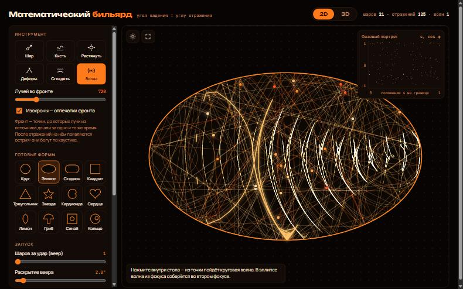
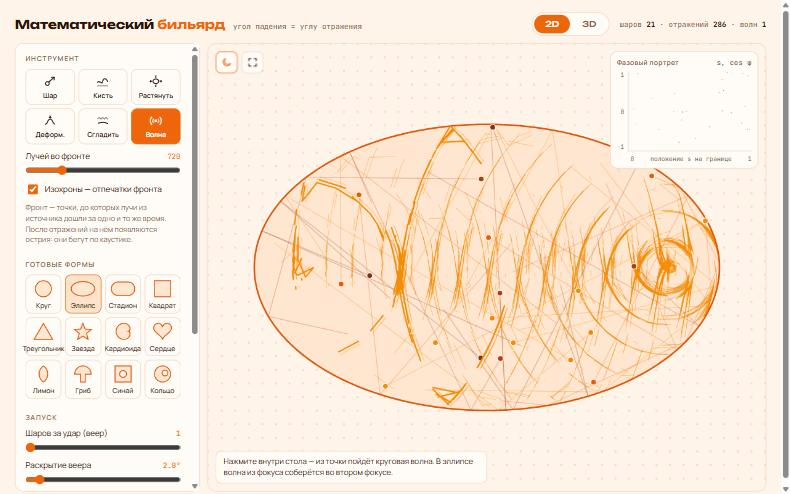

<h1 align="center">🎱 Math Billiard</h1>

<p align="center">
  <b>An interactive mathematical billiard in the browser: 2D and 3D tables, caustics, wavefronts and phase portraits.</b><br>
  <i>The angle of incidence equals the angle of reflection</i>, and from that one rule comes order, chaos and beautiful patterns.
</p>

<p align="center">
  <a href="https://the-volador42.github.io/math-billiard/"></a>
</p>

<p align="center">
  
  
  
  
  
</p>

<p align="center">
  
  <br><sub>A wave from one focus of an ellipse gathers in the other focus. Faint lines are isochrones: imprints of the front.</sub>
</p>

---

## ✨ Features

| | |
|---|---|
| 🎱 **Launch balls** | Click inside the table and drag to aim. Fire a whole **fan** of balls to watch nearby trajectories split apart. |
| 🌊 **Wavefront** | Click to send a circular wave of hundreds of rays from a point. The front joins the rays at the same moment in time; after reflections it grows cusps that slide along the caustic. **Isochrones** leave imprints of the front. |
| 🖌️ **Draw your own table** | Draw any closed shape with the brush, add obstacles inside, stretch, warp and smooth the boundary. |
| 🔷 **12 ready shapes** | Circle, ellipse, stadium, square, triangle, star, cardioid, heart, lemon, mushroom, Sinai billiard, ring. |
| 📈 **Phase portrait** | Every bounce is a point *(position on the boundary, cos φ)*: invariant curves for integrable tables, a scattered cloud for chaotic ones. |
| ✨ **Caustics** | With no fading, trails pile up and reveal caustics: confocal ellipses and hyperbolas in an ellipse, chaos in a stadium. |
| 🧊 **3D mode** | Sphere, ellipsoid, cube, cylinder, torus, 3D stadium, 3D Sinai, and a **prism extruded from your 2D drawing**. Stretch along any axis, orbit the camera. |
| 🌙 **Dark theme** | A deep black theme where trails glow. Follows the system by default, the button remembers your choice. |
| ⛶ **Fullscreen** | Put the table on the whole screen with the button or <kbd>F</kbd>. |
| 📱 **Works on phones** | Touch input and a stacked layout for small screens. |

<details>
<summary><b>Light theme</b></summary>
<p align="center"></p>
</details>

---

## 🚀 Run

**Online:** [the-volador42.github.io/math-billiard](https://the-volador42.github.io/math-billiard/)

**Locally:** it's a single `index.html` with no build step. Open it in a browser, or serve the folder:

```bash
python -m http.server 8000
```

then open http://localhost:8000. The 3D mode loads Three.js from a CDN, so it needs internet.

---

## ⌨️ Controls

| Action | How |
|---|---|
| Launch a ball | **Ball** tool: press inside the table and drag; a short click picks a random direction |
| Launch a wave | **Wave** tool: click inside the table |
| Pause / resume | <kbd>Space</kbd> |
| Fullscreen | <kbd>F</kbd> or the ⛶ button on the table |
| Dark / light theme | ☾ / ☀ button on the table |
| 3D camera | Drag to rotate, wheel or pinch to zoom |

---

## 🧮 A bit of math

- **Ellipse:** the billiard is integrable. Every trajectory touches a confocal ellipse or hyperbola (its caustic), and a wave from one focus focuses exactly in the other.
- **Circle:** the angle with the boundary never changes, so the phase portrait is a set of horizontal lines.
- **Stadium and Sinai:** chaotic. Close trajectories diverge exponentially, and the phase portrait fills up like noise.
- **Mushroom:** mixed. The cap keeps regular orbits, the stem lets chaos in.

---

## 🛠️ How it works

- **2D:** the boundary is a polygon with thousands of short segments. Each step finds the nearest segment hit by the ray and mirrors the velocity across the segment's tangent.
- **Wavefront:** N rays start from one point at equal angles and move at the same speed. Neighbouring rays are joined by a line, which breaks where they drift too far apart.
- **3D:** shapes are signed distance functions. A ray marches in small steps, bisects the exact hit point and reflects across the SDF gradient.
- Everything lives in one [`index.html`](index.html): Canvas 2D, plus [Three.js](https://threejs.org) r128 for 3D.
